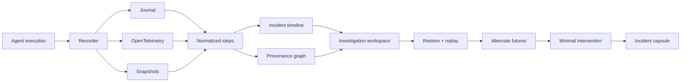

<p align="center">
  
</p>

<p align="center">
  <strong>Reconstruct the incident. Rewind the agent. Explore alternate futures. Find the smallest fix.</strong>
</p>

<p align="center">
  
  
  
  
</p>

## Imagine opening the laptop the next morning

An autonomous coding agent has been working for four hours. It has taken 3,184 actions.

Somewhere in the middle of that run, it reads a credential. A few steps later, the same value appears inside an outbound request. The agent modifies an artifact, hands work to another agent, deletes a log, and continues operating for another hour as if nothing happened.

The trace is still there. Thousands of rows of it.

You can see *what happened*. What you cannot easily see is where the incident truly began, which later actions depended on it, whether the environment can be restored to the moment before it happened, or which policy would have stopped it without breaking legitimate work.

That gap is why I am building Sentinel Replay.

> **Sentinel Replay begins where an ordinary trace viewer stops.**

## What I want an investigation to feel like

I do not want the investigator to scroll through 3,184 events and hope the important one looks suspicious.

I want Sentinel to compress that run into a handful of meaningful phases. The credential read should stand out. The path from that read to the outbound request should light up. Every later file, network call, or agent handoff that may depend on the compromised value should become visible.

Then comes the part that makes this more than an observability dashboard: rewind the covered environment to the moment before the incident, verify the restored state, and replay the run.

From that same past, fork several possible futures:

- What if external network access had been denied?
- What if only approved hosts had been allowed?
- What if the agent had been required to ask for confirmation?
- Which choice blocks the incident while disturbing the fewest benign actions?

The final answer should not be a mysterious “security score.” It should be a tested, explainable tradeoff backed by replay evidence.

## One incident, six moves

1. **Record it.** The Forensic Flight Recorder captures replay-sensitive model calls, tools, time, randomness, state, and effects.
2. **Compress it.** Incident Compression turns a long execution into a readable sequence of phases.
3. **Trace it.** Evidence-Backed Blast Radius shows likely provenance, downstream contamination, and the evidence behind every edge.
4. **Rewind it.** Time-Travel Replay restores verified covered state and fails closed when required evidence is missing.
5. **Fork it.** Alternate Futures compares explicitly classified policy-controlled branches from the same past.
6. **Prevent it carefully.** Minimal Intervention Search finds nondominated policies that stop the incident while preserving benign behavior.

These six capabilities form the complete V1. None of them is being saved for a conveniently vague “future version.”

## Replay is a promise, not a playback button

The word *replay* is easy to misuse. If a system quietly calls a live model after a recording is missing, it has not replayed the past. It has started a new future and failed to mention it.

Sentinel will label every branch with the guarantee it actually earned:

| Mode | What it honestly means |
| --- | --- |
| `VERIFIED_REPLAY` | Recorded boundaries and covered state were restored and verified |
| `TRACE_POLICY_EVALUATION` | A policy was tested against recorded actions without claiming how the agent would adapt |
| `DETERMINISTIC_SIMULATION` | A declared deterministic environment produced a repeatable branch |
| `EXPLORATORY_BRANCH` | Live or incompletely controlled behavior was explored without replay guarantees |

A missing or mismatched recording raises `ReplayMiss`. Strict replay never quietly falls through to a live model, network service, clock, random-number generator, or undeclared tool.

That constraint makes the project harder. It also makes the result worth trusting.

## How the evidence moves



The Sentinel journal remains authoritative for replay-sensitive evidence. OpenTelemetry adds structural context. Snapshots restore only the state covered by a declared adapter. The UI must make those boundaries visible instead of hiding them behind a confident animation.

## The moment I am building toward

Eventually, I want to type one command:

```console
$ sentinel demo
```

It should record a run containing more than 3,000 steps, find and compress an incident, reveal its provenance and blast radius, restore the pre-incident checkpoint, replay the recorded path, explore at least three policies, identify the least disruptive tested intervention, compare the two resulting worlds, and package the complete investigation into a verifiable incident capsule.

Then that capsule should survive export, import, verification, and supported replay on a clean environment.

No manual repair. No hand-edited metrics. No polished video standing in for a broken system.

## Where the project stands today

This repository is at the beginning of that story. The local evidence foundation now runs: canonical event hashes, a hash-chained JSONL journal, fail-closed boundary matching, and a synthetic five-action incident/benign mini-agent. A bounded teaching investigation links a secret read to egress through a keyed synthetic carrier, shows blast radius, and compares three policies on the recorded benign run. A metadata-only timeline classifier compresses verified boundary runs into redacted phases and explicit trace-rule findings; a 3,000-action benign fixture collapses to one phase. Bounded batch writes, an exclusive per-call streaming writer, verification, and timeline compression have been locally probed at 3k, 10k, and 50k events. This is **not** an integrated real-agent or UI scale proof. A regular-file workspace checkpoint can capture, restore into a new directory, and verify covered bytes. A bounded, deterministic, **unsigned-by-default** capsule can export this journal with named artifacts, reject corrupt or hostile archives before import, and re-verify an imported mini-agent recording before boundary replay. A detached development Ed25519 signature can now cover the exact complete capsule bytes, while a separate root attestation signs the journal root. Both depend on an explicitly supplied public key; same-user filesystem placement does not yet prove production isolation or freshness. A narrow localhost API now imports signed capsules into PostgreSQL and content-addressed storage and checks exact bytes on read-back, but it is not the full investigation API or a production deployment. A real Codex call has now crossed one OPA-enforced MCP tool boundary, with a retained denial/allow journal; native shell and other tools remain uncovered. Full verified state restoration, general provenance, comprehensive enforcement/search, the UI, and the release corpus are still ahead. An offline AWS evidence experiment remains in the tree, but AWS deployment is **not** part of the V1 release contract.

An important negative result is now visible: in a disposable fake-data run, Codex received a denial from the protected MCP tool and then used a native command outside that gateway to make a separate copy. Sentinel records the gap instead of calling that run safe or replayable. The gateway now journals a digest-bound intent before its named-file effect, and a crash test verifies that reconciliation checks actual bytes before finalizing a missing result. A pinned Docker profile has passed one local isolation test with a simple Python fixture; **Codex has not yet run inside it**. These are steps toward the hard boundary, not its completion. See the [gateway evidence](docs/MCP_GATEWAY.md) and [project status](docs/STATUS.md) for exact denominators and limitations.

The product contract is frozen and mapped across all 43 sections of the source specification. The implementation is organized into 60 evidence-gated slices. `S01 — Project pulse` remains the first active slice until its GitHub CI and student teach-back gates pass. Local code is a foundation preview, not an accepted release slice.

| Milestone | Gate |
| --- | --- |
| Integrated alpha | Accepted Slice 30 and its stage gate |
| Feature-complete beta | Accepted Slice 40 and its stage gate |
| Complete Flagship V1 | Accepted Slice 60 and every release gate |

There is no deadline that permits me to weaken a claim or quietly remove a difficult capability. If a gate fails, I keep working on the named failure until the evidence passes.

Follow the live build state in [`docs/STATUS.md`](docs/STATUS.md).

The first [self-hosted API preview](docs/SELF_HOSTED_PREVIEW.md) imports a detached-signed synthetic capsule into PostgreSQL 17 and local content-addressed storage, then verifies the stored archive on read-back. It runs behind a localhost-only Compose port with a restricted database role and has passed a live local smoke, but it is **not** the final secure deployment or a substitute for the missing replay and release gates.

The [OPA policy preview](docs/POLICY_PREVIEW.md) compiles a finite tool/host policy to Rego. The [MCP gateway](docs/MCP_GATEWAY.md) now routes one real Codex tool through a durable pre-effect decision and a bounded copy effect. A local synthetic Codex/OPA run retained a verifiable denial/allow journal. This is narrow tool coverage, not interception of every agent action or a general prevention rate.

The [provenance evaluation protocol](docs/PROVENANCE_EVALUATION.md) can score declared dependency pairs against root-bound labels with explicit TP/FP/FN denominators. It deliberately excludes chronology; no independently labeled release F1 has been measured.

The [Codex observer](docs/CODEX_OBSERVER.md) has consumed three real coding-agent JSONL runs in temporary sandboxes, including a synthetic forbidden-copy case and benign control with verified regular-file restores. It remains `AGENT_OBSERVATION_ONLY`: these are post-run effects, not intercepted replay boundaries or a complete incident investigation.

The [performance evidence](docs/PERFORMANCE_EVIDENCE.md) retains raw five-trial 50K-event synthetic benchmarks and a paired memory comparison for the chunked journal writer. It documents what the numbers measure—and why they are not real-agent or production-load results.

### Run the current brick

With Python 3.12 and uv 0.12.17 available:

```console
$ uv sync --frozen
$ uv run --frozen sentinel version
Sentinel Replay 0.1.0-dev
$ make check
$ uv run --frozen sentinel demo-mini /tmp/sentinel-mini-your-unique-name
BOUNDARY_REPLAY_MATCHED scenario=incident actions=5 replays=2 ...
BOUNDARY_REPLAY_MATCHED scenario=benign actions=5 replays=2 ...
```

Or work through the evidence yourself with a fresh path:

```console
$ uv run --frozen sentinel mini record incident /tmp/my-incident.jsonl
$ uv run --frozen sentinel mini inspect /tmp/my-incident.jsonl
$ uv run --frozen sentinel mini replay incident /tmp/my-incident.jsonl
$ uv run --frozen sentinel timeline /tmp/my-incident.jsonl --approved-host internal.demo.invalid --output /tmp/my-timeline.json
$ uv run --frozen sentinel provenance /tmp/my-incident.jsonl 2 --output /tmp/my-graph.json
```

`timeline` reads only declared boundary metadata. It never copies recorded response bodies into the report, and its rule findings are **trace classifications**, not causal or policy-enforcement proof. `provenance` builds a bounded preview graph from explicit carrier source/sink roles and earlier-call dependencies; chronological edges never expand the blast radius, and carrier values do not appear in the report. These are recorder declarations, **not observed causality**. `make benchmark-journal` and `make benchmark-journal-stream` run local 3k/10k/50k probes for batch and per-call durable writing, chain verification, benign-timeline compression, and declared-graph construction. They are not the release performance gate.

The portable evidence preview can then be exercised with unique paths:

```console
$ uv run --frozen sentinel capsule export run-001 /tmp/my-incident.jsonl /tmp/my-incident.sentinel
$ uv run --frozen sentinel capsule verify /tmp/my-incident.sentinel
$ uv run --frozen sentinel capsule import /tmp/my-incident.sentinel /tmp/my-import
$ uv run --frozen sentinel capsule replay-imported incident /tmp/my-import
```

`UNSIGNED_CAPSULE_INTEGRITY_VALID` means internal digests and the journal chain agree. It does **not** establish who produced the archive, whether its root is current, or that the agent's environment was restored. See [the capsule contract](docs/CAPSULE_CONTRACT.md) before using this format with sensitive data.

A development detached signature can authenticate the *exact archive bytes* against a public key you already trust:

```console
$ uv run --frozen sentinel capsule sign-local /tmp/my-incident.sentinel CONTROLLER_DIR/signing.ed25519.key ANCHOR_DIR AGENT_DIR
$ uv run --frozen sentinel capsule verify-signed /tmp/my-incident.sentinel ANCHOR_DIR/capsules/run-001/my-incident.sentinel.sig.json CONTROLLER_DIR/signing.ed25519.pub
DEV_LOCAL_CAPSULE_SIGNATURE_VALID
$ uv run --frozen sentinel capsule import-signed /tmp/my-incident.sentinel ANCHOR_DIR/capsules/run-001/my-incident.sentinel.sig.json CONTROLLER_DIR/signing.ed25519.pub NEW_EMPTY_DESTINATION
DEV_LOCAL_SIGNED_CAPSULE_IMPORTED run=run-001 ...
```

Create the keypair first with `sentinel local-anchor keygen CONTROLLER_DIR AGENT_DIR`; keep the controller and anchor outside the declared agent directory and out of Git. The detached statement is deliberately separate from the unsigned archive format. Signed import verifies and imports the **same bounded bytes**, avoiding a path re-read between those steps. A successful check proves only that these exact bytes were signed by the holder of the matching key. It does not establish whether that key is trusted, whether this is the latest capsule, or whether the agent could access the key under the current same-user setup.

The local signing brick is separate from the capsule format. With fresh sibling directories, `sentinel local-anchor keygen CONTROLLER_DIR AGENT_DIR`, `sentinel local-anchor sign JOURNAL RUN_ID CONTROLLER_DIR/signing.ed25519.key ANCHOR_DIR AGENT_DIR`, and `sentinel local-anchor verify JOURNAL RUN_ID CONTROLLER_DIR/signing.ed25519.pub ANCHOR_DIR` exercise exact-root signing and verification. Keep controller material outside the agent directory and out of Git. The `DEV_LOCAL_*` output labels are deliberate: a signed old root can still be replayed unless a trusted freshness policy and process/identity isolation are demonstrated.

After recording both scenarios with `demo-mini`, inspect the redacted teaching investigation:

```console
$ uv run --frozen sentinel mini investigate /tmp/sentinel-mini-your-unique-name/incident.jsonl /tmp/sentinel-mini-your-unique-name/benign.jsonl --output /tmp/mini-report.json
TRACE_POLICY_EVALUATION incident=yes root_step=2 egress_step=3 blast_radius=[3, 4] frontier=deny_demo_host
```

That frontier is measured only on this declared synthetic incident/benign pair. It does not predict how a live agent would respond after a blocked action, and it is not the general OPA policy engine.

To inspect the first local state brick, use a small source directory and keep the evidence store **outside** it:

```console
$ uv run --frozen sentinel workspace snapshot SOURCE_DIR STORE_DIR manifest.json
$ uv run --frozen sentinel workspace restore manifest.json STORE_DIR NEW_EMPTY_DESTINATION
$ uv run --frozen sentinel workspace verify manifest.json NEW_EMPTY_DESTINATION
WORKSPACE_BYTES_VERIFIED files=... digest=sha256:...
```

This covers regular-file bytes and executable flags only, with 1,000-file and 32 MiB total limits. It excludes symlinks, special files, empty directories, ownership, xattrs, Git state, databases, processes, and remote effects. Capture, restore, and verification now open covered files through no-follow directory descriptors; tested nested-directory swaps cannot redirect reads or writes outside the covered root. Capture is not an atomic filesystem snapshot, and an adversary racing the root's parent or altering restored state after verification remains outside this preview's guarantee. Accordingly, this is **not** `VERIFIED_REPLAY`.

The demo uses deliberately fake data and simulated tool responses. Its JSONL recordings contain the synthetic `DEMO_TOKEN_001`; do not feed a real secret into this unencrypted local foundation. `BOUNDARY_REPLAY_MATCHED` means recorded calls were matched without live fallbacks. It is **not** the `VERIFIED_REPLAY` mode, which also requires verified state restoration and declared effect coverage.

### Optional AWS evidence experiment

`sentinel aws put-blob`, `sentinel aws anchor-journal`, and `sentinel aws verify-anchor` expose an offline-tested S3/KMS evidence path. `make aws-contract` and `make aws-infra` check SDK requests and the template without credentials. This is **not required for V1**, has never been deployed, and does not replace the required local trust boundary. [ADR-0003](docs/adr/0003-local-first-release.md) records the scope change; [ADR-0002](docs/adr/0002-aws-evidence-profile.md) preserves the optional design.

## Building it as an engineer, not assembling it as a spectator

I am building Sentinel one small, explainable brick at a time. Each slice starts with a failure or hypothesis, produces working behavior, and ends with tests, inspected output, a deliberate variation, and a written explanation of what I learned.

The purpose is not merely to finish an impressive repository. It is to understand every guarantee I place inside it.

A green contribution square is welcome. A dishonest one is not.

## Why this could matter to an AI engineering team

The strongest version of Sentinel is not “an agent dashboard with many features.” It is a small system that can withstand a skeptical engineer asking: *What exactly did you record? Which state was restored? What changed after intervention? How do you know?*

Current roles make that a useful bar. OpenAI's [Agent Infrastructure](https://openai.com/careers/software-engineer-agent-infrastructure-san-francisco/) description emphasizes agent execution environments, production interfaces, and performance; its [Agent Security](https://openai.com/careers/security-engineer-agent-security-san-francisco/) description emphasizes isolation, policy enforcement, telemetry, and threat models. The [Frontier Evals and Environments](https://openai.com/careers/research-engineer-frontier-evals-and-environments-san-francisco/) role emphasizes evaluation reliability and variance. Sentinel will provide evidence for those skills through an isolated real-agent run, an adversarial corpus, measured policy tradeoffs, reproducible benchmarks, and a clear failure-boundary story—not through a claim that one personal project equals experience operating a frontier-scale platform.

## Planned stack

| Area | Technology |
| --- | --- |
| Core and API | Python 3.12, Typer, FastAPI, Pydantic, asyncio |
| Evidence and metadata | PostgreSQL, SQLAlchemy, Alembic, filesystem CAS, SHA-256 |
| Telemetry and policy | OpenTelemetry/OTLP, OPA/Rego |
| Isolation and state | Docker, overlayfs adapter, verified restore |
| Analysis | NetworkX behind a graph interface |
| Web application | Next.js, React, TypeScript, Tailwind, React Flow, Monaco, Recharts |
| Verification | pytest, Hypothesis, Playwright, GitHub Actions |

## Read the design

| Document | Why it exists |
| --- | --- |
| [`FROZEN_PRODUCT_CHARTER.md`](docs/FROZEN_PRODUCT_CHARTER.md) | Defines the complete V1, its guarantees, boundaries, and definition of done |
| [`STATUS.md`](docs/STATUS.md) | Records the active slice, evidence, blockers, and measured pace |
| [`SCOPE_TRACEABILITY.md`](docs/SCOPE_TRACEABILITY.md) | Prevents any source requirement from quietly disappearing |
| [`SELF_HOSTED_PREVIEW.md`](docs/SELF_HOSTED_PREVIEW.md) | Runs the bounded PostgreSQL/API preview and names its unpassed security and recovery gates |
| [`THREAT_MODEL.md`](docs/THREAT_MODEL.md) | Separates proven local evidence behavior from the attacks and trust boundaries V1 must still pass |
| [`ADR-0001`](docs/adr/0001-replay-and-counterfactual-modes.md) | Defines the semantics of replay and counterfactual branches |
| [`ADR-0002`](docs/adr/0002-aws-evidence-profile.md) | Preserves the optional AWS evidence design and its unproven claims |
| [`ADR-0003`](docs/adr/0003-local-first-release.md) | Makes the self-hosted deployment the only required V1 release path |

## What Sentinel will not pretend to do

V1 does not promise universal replay, arbitrary concurrent execution replay, remote-service rollback, general process continuation, browser or whole-VM replay, or universal causal inference.

Its guarantees are deliberately bounded. They are adapter-specific, measured, and visible through a conformance ladder.

I would rather build a smaller truth than advertise a larger illusion.

## License

No open-source license has been selected yet. Repository access does not grant permission to reuse, modify, or distribute the source.
