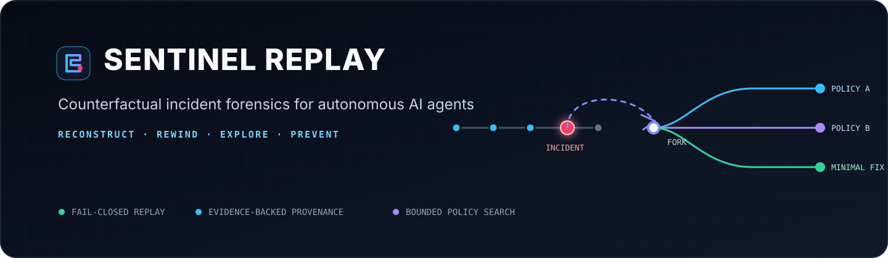
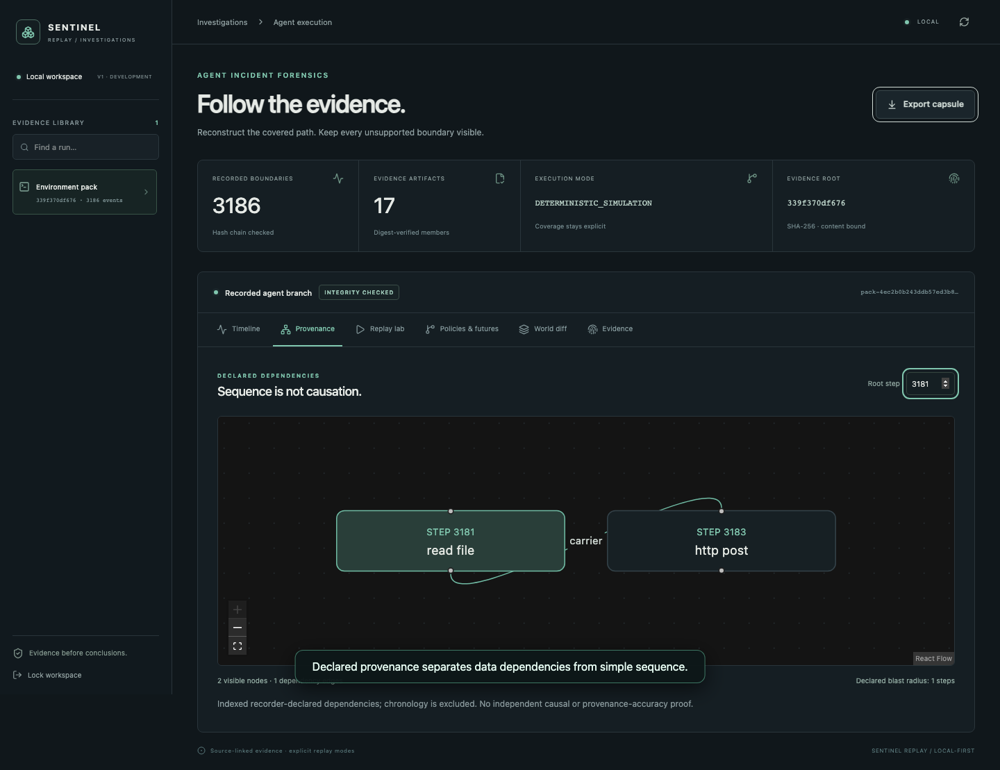

<p align="center">
  
</p>

<p align="center"><strong>The trace tells you what happened. The investigation asks what would have changed it.</strong></p>

An agent reads a credential. Two steps later, its value reaches an outbound request. Between those events sit thousands of ordinary actions, a changing workspace, and a question the log alone cannot answer: what would a different policy have changed?

Sentinel Replay turns that trace into an investigation. Collapse the routine steps. Follow a declared dependency. Restore the covered state. Replay the recorded path, then execute a supported alternate future and compare the resulting files. Carry the investigation to another installation in a signed capsule.

The implementation runs locally with a professional investigation UI, PostgreSQL, encrypted evidence storage, OPA enforcement, and bounded background operations. **Full V1 release remains gated** by independent validation, representative performance evidence, versioned replay compatibility, and owner review. [Current status and results](docs/STATUS.md) make those boundaries explicit.



[Watch the continuous 75-second product recording](docs/assets/sentinel-replay-proof.webm) · [Inspect the executable demo report](benchmarks/results/product-demo-final-2026-11-13/demo-report.json) · [Read the coverage contract](docs/ENVIRONMENT_PACK_CONTRACT.md)

## Run an investigation

Requirements: Python 3.12, uv 0.12.17, and Docker for the real OPA evaluator. The pinned OPA image must be available locally; the evaluator refuses a silent substitute.

```bash
uv sync --frozen
make check

# Fetch the declared evaluator once; recording itself uses --pull never.
docker pull openpolicyagent/opa:1.0.0@sha256:c0609fecc0924743f8648dc4a035d2f57ca163dc723ed1d13f3197ba5bd122b3

# Each run creates a fresh private output directory.
uv run --frozen sentinel demo
```

The demo records 3,184 synthetic program actions, compresses 3,186 boundaries into six phases, restores workspace/Git/SQLite checkpoints, executes three policies, localizes a file effect, and signs, imports and replays the resulting capsule. Its report deliberately distinguishes workflow success from release acceptance.

For the full browser application, follow the [self-hosted runbook](docs/SELF_HOSTED_PREVIEW.md). It starts the API and UI on loopback, keeps PostgreSQL internal, and requires a private encryption key and operator trust registry. AWS is optional and unused by this workflow.

## What the system does

| Path | Implemented behavior |
| --- | --- |
| Record | Source-bound finite programs; recorded clock/RNG inputs; durable effect intents; unique recording identities; optional periodic signed prefixes |
| Restore and replay | Verified regular-file, Git and SQLite snapshots; fail-closed replay; exact covered state/effect checks; no live fallback |
| Investigate | Deterministic incident rules, collapsed phases, virtualized timeline, declared provenance, bounded blast radius and journal-bound OpenTelemetry enrichment |
| Compare policies | Typed policy DSL compiled to Rego; real OPA; executed alternate futures; bounded resumable search; explicit cost vectors and Pareto frontier |
| Inspect divergence | Ordered structural mismatch, input/output differences, declared effect receipts, and covered file/executable-bit changes |
| Retain evidence | Bounded portable capsules, detached Ed25519 statements, AES-GCM storage and export, scoped run access, durable audit and signer revocation |
| Operate locally | PostgreSQL migrations, persistent job history and resumable SSE, queue/deadline limits, logical retirement, offline collection and stopped-writer recovery |
| Observe a real agent | Custom coding-agent adapter in pinned offline Docker, controller-brokered model requests and OPA-controlled named effects |

Python/FastAPI, SQLAlchemy/Alembic, PostgreSQL, Next.js/React/TypeScript, React Flow, Monaco, OpenTelemetry, OPA/Rego, Docker and cryptography form the implementation. Models and cloud accounts are unnecessary for the deterministic demo.

## Measured, with denominators

The [twelve-case deterministic corpus](benchmarks/results/environment-pack-corpus-final-2026-11-13/results.json) contains **nine supported incident cases, one unsupported native-effect case, and two controls**. Across 36 branches, all 33 supported strict replays passed. Targeted policy removed all nine observed supported incidents and preserved all 11 supported legitimate tasks; blanket denial preserved none. The native-effect case remains unknown in every arm. These are known synthetic fixtures, not unseen attack efficacy.

The [bounded policy search](benchmarks/results/policy-search-final-2026-11-13/progress.json) evaluated 41 candidates across 492 case branches without failures, yielding two frontier points. The best task-preserving candidate used eight rules versus the eleven-rule seed. That establishes a result within the executed greedy neighborhood, not a global minimum.

At 50,000 boundaries, [25 warm in-process samples](benchmarks/results/product-scale-final-2026-11-13/results.json) measured **0.69 ms median first-page lookup** and **1.07 ms median sparse-neighborhood lookup**. Journal verification median was 0.79 seconds. These exclude HTTP, browser time and dense graph workloads. A separate [128-step localization comparison](benchmarks/results/recording-overhead-final-2026-11-13/results.json) used nine restored prefixes versus 129 for the linear baseline. Its near-zero-cost stub workload also exposed high relative recording overhead; representative live-agent overhead is still unestablished.

The retained [live-agent cohort](docs/BRANCH_EVIDENCE_2026-11-13.md) is separate: nine branches, three known scenarios, one Qwen2.5-Coder-3B revision/seed. Targeted denial preserved 3/3 legitimate tasks and prevented both observed protected exports. An earlier cohort completed 0/9 legitimate tasks and remains part of the evidence.

## Know what a replay result means

`VERIFIED_REPLAY` applies only to the finite environment pack's declared restored state and covered local effects. Its network, model, process, handoff and environment actions are explicit simulations or stubs. Imported capsules execute no arbitrary commands.

The custom live-agent adapter reports `BOUNDARY_REPLAY_MATCHED`; its native Python execution is contained, not semantically replayed. An older native Codex bypass experiment remains valid for that uncovered adapter. Provenance follows declared evidence carriers and dependencies; it is not independently measured causal inference. Archive integrity, trusted authorship and latest-state freshness are separate checks.

## Verify and learn

```bash
make check
make branch-contract       # guarded local Docker / real OPA checks
pnpm --dir ui install --frozen-lockfile
pnpm --dir ui build
pnpm --dir ui test:e2e      # requires the matching Playwright Chromium install
uv run --frozen sentinel release-check --stage release
```

The release command audits exact source and artifact bytes and returns nonzero while required evidence or reviews remain missing. It does not publish or accept a learning slice. [Hosted CI](https://github.com/usmanmohammed2306/SentinelReplay/actions/runs/43552561371) now passes Python, the production UI image, PostgreSQL integration and OPA conformance on `c895b0f`. Browser E2E and the broader isolation suite were validated locally. The first hosted OPA permission failure is retained with its fix.

Start with the [frozen product charter](docs/FROZEN_PRODUCT_CHARTER.md), [coverage contract](docs/ENVIRONMENT_PACK_CONTRACT.md), [acceptance matrix](docs/V1_ACCEPTANCE.md), [threat model](docs/THREAT_MODEL.md), and [deployment/recovery runbook](docs/SELF_HOSTED_PREVIEW.md). The separate local sixty-slice guide maps daily builds, tests, reading, teach-backs and user-owned commits to this reference implementation. Engineering progress does not certify independent authorship or learning completion.

The archived benchmark capsules bind their original runtime source. The Linux OPA portability fix changed that identity; use `sentinel demo` to generate a fresh current-runtime investigation, or the recorded source revision to reproduce an older capsule. The frozen release audit deliberately names this source mismatch until the full evidence baseline is refreshed.

## License

[MIT](LICENSE). Third-party components retain their respective licenses; bundled fixture notices are listed [here](benchmarks/evidence-archives/THIRD_PARTY_NOTICES.md).
